<div align="center">

# n8n-hubspot-nps-detractor-slack-huddle-provisioner

**Customer success emergency response workflow that triggers an instant internal Slack huddle and assigns a retention task when an enterprise customer submits a detractor NPS score.**

A dhRobin Systems Revenue Infrastructure blueprint

    

</div>

---

## Table of Contents

1. [Overview](#1-overview)
2. [Architecture and Data Flow](#2-architecture-and-data-flow)
3. [Repository Contents](#3-repository-contents)
4. [Prerequisites](#4-prerequisites)
5. [5-Minute Sandbox Quick Start](#5-5-minute-sandbox-quick-start)
6. [Step-by-Step Import and Configuration Guide](#6-step-by-step-import-and-configuration-guide)
7. [Environment Variables](#7-environment-variables)
8. [Node-by-Node Configuration Guide](#8-node-by-node-configuration-guide)
9. [NPS Detractor Logic, Enterprise Tier Filters and False-Positive Protections](#9-nps-detractor-logic-enterprise-tier-filters-and-false-positive-protections)
10. [Safety Matrix](#10-safety-matrix)
11. [Data Protection and Compliance Checklist (GDPR / CCPA)](#11-data-protection-and-compliance-checklist-gdpr--ccpa)
12. [Operations and Troubleshooting](#12-operations-and-troubleshooting)
13. [Disclaimer and License](#13-disclaimer-and-license)

---

## 1. Overview

An enterprise customer who answers "2" on an NPS survey is telling you, in the only channel you gave them, that the renewal is in danger. In most teams that answer lands in a survey report reviewed weeks later.

I built this workflow to treat it as an incident. When an NPS response arrives in HubSpot, it reads the score and comment, resolves the contact and company, and decides how urgent it is. An enterprise detractor gets an `@here` Slack alert with huddle instructions, a meeting room link and links to the HubSpot company, contact, retention task and ticket. It also gets a HIGH-priority retention task for the CSM (due in 4 hours) and an emergency ticket. The company is marked `retention_status = At Risk`, with `last_nps_score` stamped. Growth detractors get an alert and a task, SMB detractors a follow-up task, and passives and promoters only a score stamp.

**Outputs per submission**

| Field | Values |
|---|---|
| `nps_category` | `detractor` (0–6), `passive` (7–8), `promoter` (9–10) |
| `segment` | `enterprise`, `growth`, `smb` |
| `response_tier` | `emergency`, `high`, `standard` |
| `action` | `huddle_task_ticket`, `alert_task`, `task`, `none` |
| `signals[]` | `sentiment drop: 9 → 5`, `repeat detractor`, `renewal in 60 days`, `churn language: other vendors` |

**Design principles**

| Principle | Implementation |
|---|---|
| Safe by default | With no environment variables set, the workflow makes **zero HubSpot calls, zero Slack calls and zero writes**. Alerts need `SEND_SLACK_ALERTS=true`, tasks, tickets and properties need `WRITE_TO_HUBSPOT=true`, and both also need `SANDBOX_MODE=false` and `DRY_RUN=false`. |
| One incident per account | Two detractors from the same company in one run produce one huddle alert, one task and one ticket. A per-company cooldown prevents a second response within `COOLDOWN_HOURS`, unless the tier rises. |
| Exactly once | Submissions already processed (workflow memory, or the company's `last_nps_submission_id`) are skipped, so HubSpot retries or overlapping polls don't create duplicate tasks. |
| Real customers only | Internal submitters, test accounts, non-NPS surveys, stale submissions and missing scores are filtered out before anything happens. |
| Task first, then Slack | CRM records are created before the alert, so Slack links straight to the new task and ticket. |
| Secrets out of data | The HubSpot token and Slack URLs appear only as `{{ $env.* }}` in HTTP header and URL fields. The one documented exception is the inbound webhook token ([§8.2](#82-parse--verify-webhook)). |

> **About "instant huddles":** Slack incoming webhooks can't start a huddle on someone's behalf. The alert @mentions the responders, tells them to start a huddle in the channel, and links a standing meeting room (`HUDDLE_MEETING_URL_TEMPLATE`, e.g. a Zoom or Google Meet war room) as a fallback.

---

## 2. Architecture and Data Flow

```mermaid
flowchart LR
    WH[NPS Submission Webhook<br/>HubSpot workflow 'Send a webhook'] --> CFG
    PO[NPS Polling Schedule<br/>every 15 min] --> CFG
    MAN[Manual Test Trigger] --> CFG[Config & Safety Gate]
    CFG --> FW{From Webhook?}
    FW -- yes --> PV[Parse & Verify Webhook<br/>shared token] --> SB
    FW -- no --> SB{Sandbox Mode?}
    SB -- yes --> MOCK[Mock NPS Context<br/>sample-payloads/hubspot-nps-responses.json]
    SB -- no --> WI{Webhook Items?}
    WI -- no --> SR[HubSpot: Search NPS Submissions] --> BSR
    WI -- yes --> BSR[Build Submission Reads]
    BSR --> RS[Batch Read Submissions] --> AS[Submission → Contact] --> BC[Build Contact Reads] --> RC[Batch Read Contacts] --> BCO[Build Company Reads] --> RCO[Batch Read Companies] --> ASM[Assemble NPS Context]
    MOCK --> AN
    ASM --> AN[Detractor & Enterprise<br/>Urgency Analysis]
    AN --> PL[Plan Response Actions<br/>group by company · cooldown · payloads]
    PL --> WG{Write Gate}
    WG -- yes --> T{Tasks?} -- yes --> CT[Create Retention Tasks] --> K
    T -- no --> K{Tickets?}
    K -- yes --> CK[Create Emergency Tickets] --> U
    K -- no --> U{Company Updates?}
    U -- yes --> CU[Update Company Properties] --> CR
    U -- no --> CR[Collect CRM Results]
    CR --> SLB
    WG -- no --> SLB[Build Slack Emergency Alerts<br/>huddle prompt · record links]
    SLB --> SG{Slack Gate}
    SG -- yes --> EM[Emit Slack Messages] --> SP[Slack: Post Emergency Alert] --> CSR[Collect Slack Results] --> SUM
    SG -- no --> SUM[Build Run Summary]
    SUM --> SW{Summary Webhook?}
    SW -- yes --> WS[Webhook: Post Run Summary] --> AUD
    SW -- no --> AUD[Execution Summary & Audit]
```



### Stage contracts

| Stage | Output shape |
|---|---|
| Parse & Verify Webhook | `{ auth, received, ids[], inline[{ submissionId, contactId, score, comment, surveyType, submittedAt }], ignored[] }` |
| Mock NPS Context / Assemble NPS Context | `{ source, submissions: [{ submissionId, score, comment, surveyType, surveyName, submittedAt, contact{ id, name, email, jobTitle }, company{ id, name, domain, tier, arr, ownerId, previousNps, renewalDate, lastAlertAt, lastAlertTier, lastSubmissionId } }], readErrors[] }` |
| Detractor & Enterprise Urgency Analysis | `{ counts, results: [{ submissionId, evaluated, skipReason, nps_category, segment, response_tier, action, reason, signals[], sentiment_delta, renewal_in_days, churn_signals[], should_act, comment_preview }] }` |
| Plan Response Actions | Same, plus `plans[{ companyId, tier, acting[], cooldown, route, alert, task, ticket }]`, `suppressed[]`, `taskBody`, `ticketBody`, `companyBody`, `writeAllowed` |
| Collect CRM Results | `{ tasks{ byCompany }, tickets{ byCompany }, companies{ updated } }` with error details |
| Execution Summary & Audit | Outcome, safety flags, thresholds, per-submission category, segment, tier and skip reason, per-company actions, suppressions, CRM and Slack results (no comments or contact details) |

---

## 3. Repository Contents

```
n8n-hubspot-nps-detractor-slack-huddle-provisioner/
├── README.md                             Technical documentation (this file)
├── workflow.json                         Importable n8n workflow with sticky notes and pinned synthetic payloads
├── DISCLAIMER.md                         Liability limitation and usage terms
├── LICENSE                               MIT License
└── sample-payloads/
    └── hubspot-nps-responses.json        14 synthetic NPS submissions + contacts + companies (also embedded in the sandbox node)
```

All companies, people, emails, owner IDs and Slack member IDs are fictitious. Dates are relative offsets resolved at run time.

---

## 4. Prerequisites

| Requirement | Detail |
|---|---|
| n8n | Self-hosted **1.60 or later** (Webhook 2, Schedule Trigger 1.2, Set 3.4, IF 2, Code 2, HTTP Request 4.2, `$('Node').isExecuted`, `v1` execution order). |
| Env access | `N8N_BLOCK_ENV_ACCESS_IN_NODE=false`, so `{{ $env.* }}` expressions resolve. |
| Crypto in Code nodes | `NODE_FUNCTION_ALLOW_BUILTIN=crypto` for the webhook token check. |
| HubSpot private app scopes | **`crm.objects.contacts.read`**, **`crm.objects.companies.read`**, **`crm.objects.tasks.write`** (retention tasks; use the write scope HubSpot lists for the Tasks API in your portal), **`crm.objects.tickets.write`** (emergency tickets), plus **`crm.objects.feedback_submissions.read`** to read NPS responses, and **`crm.objects.companies.write`** to set `retention_status` and `last_nps_score`. |
| HubSpot surveys | A customer loyalty (NPS) survey. Responses are stored as **feedback submissions**, a read-only CRM object whose score is `hs_value` and comment `hs_response_text`. |
| HubSpot company properties | Read: `customer_tier` (or your tier property), `annual_contract_value`, `renewal_date`, `hubspot_owner_id` (CSM). Written (create first): `retention_status` (dropdown with an *At Risk* option), `last_nps_score` (number), `last_nps_category`, `last_nps_submission_id`, `last_nps_alert_at`, `last_nps_alert_tier` (text). |
| Real-time trigger (recommended) | A HubSpot workflow, enrolled when an NPS survey response is submitted, with a **Send a webhook** action POSTing `{ "feedbackSubmissionId": "<id>" }` (or `{ "contactId", "score", "comment" }`) to the n8n production URL, with the header `Authorization: Bearer <WEBHOOK_SHARED_TOKEN>`. |
| Slack | An incoming webhook for the CS emergency channel, and optionally one for a lower-priority alerts channel. |

> **n8n Cloud:** you can't define your own environment variables there, and Code nodes can't load `crypto`. Replace `$env.X` with `$vars.X` (on plans with Variables), and use the polling fallback, or `REQUIRE_WEBHOOK_TOKEN=false` behind another protection layer.

---

## 5. 5-Minute Sandbox Quick Start

1. **Run n8n locally:**
   ```bash
   docker run -it --rm -p 5678:5678 \
     -e N8N_BLOCK_ENV_ACCESS_IN_NODE=false \
     -e NODE_FUNCTION_ALLOW_BUILTIN=crypto \
     -e GENERIC_TIMEZONE=UTC \
     -v n8n_data:/home/node/.n8n \
     docker.n8n.io/n8nio/n8n
   ```
2. **Import** `workflow.json` (*Workflows → Import from File*).
3. Click **Test workflow** on *Manual Test Trigger*.
4. Open **Detractor & Enterprise Urgency Analysis**, **Plan Response Actions**, **Build Slack Emergency Alerts** and **Execution Summary & Audit**.

**Expected sandbox result** (14 synthetic submissions, nothing sent or written):

| Submission | Company (tier) | Score | Result |
|---|---|:---:|---|
| `3300001` Sarah Jenkins | Apex Logistics (Enterprise) | 2 | 🚨 **emergency**: renewal in 60 days, churn language "other vendors" |
| `3300010` Marcus Reid | Apex Logistics (Enterprise) | 3 | 🚨 **emergency**, grouped with 3300001 into **one** huddle alert, task and ticket |
| `3300002` Marcus Vance | Vanguard Cloud (Enterprise) | 5 | 🚨 **emergency**: sentiment drop 9 → 5 |
| `3300013` Camille Durand | Lumiere Optique (Enterprise) | 6 | ⏸️ emergency, but the company was alerted 6 h ago: no second alert, task or ticket. Score still stamped |
| `3300003` Priya Nair | Orchid Health (Growth) | 4 | ⚠️ **high**: alert + task, sentiment drop 8 → 4 |
| `3300004` Diego Alvarez | Summit Retail (Growth) | 6 | ⚠️ **high**: churn language "competitor, switching", renewal in 45 days |
| `3300005` Hannah Cole | Brightwater Labs (SMB) | 3 | standard: follow-up task only |
| `3300006` Tom Becker | Northwind Media (Enterprise) | 7 | standard: passive, score stamped |
| `3300007` Lena Vogel | Kestrel Fintech (Enterprise) | 10 | standard: promoter, score stamped |
| `3300008` internal reviewer | `@company.example` | 0 | Skipped: `internal_submission` |
| `3300009` test user | QA Test Account | 1 | Skipped: `test_account` |
| `3300011` Jordan Lee | Harbor Freightways (Enterprise) | 4 | Skipped: `older_than_max_age` (5 days) |
| `3300012` Tom Becker | Northwind Media | 2 | Skipped: `not_nps_survey (CSAT)` |
| `3300003` (again) | Orchid Health | 4 | Skipped: `duplicate_in_run` |

Outcome `responses_found_sandbox`: 4 Slack alerts built (2 emergency, 2 high), plus prepared payloads for 5 tasks, 2 tickets and 8 company updates. The sandbox uses a synthetic `EMERGENCY_ROUTING` with placeholder Slack IDs when it's unset.

---

## 6. Step-by-Step Import and Configuration Guide

Each step changes one thing and has an exit check.

| Step | Configuration | Exit check |
|---|---|---|
| **1. Import and sandbox** | Defaults | The table in [§5](#5-5-minute-sandbox-quick-start) is reproduced. |
| **2. Define your segments** | `ENTERPRISE_TIERS`, `GROWTH_TIERS`, `COMPANY_TIER_PROPERTY`, optionally `ENTERPRISE_ARR_THRESHOLD` + `ARR_PROPERTY`, `RENEWAL_DATE_PROPERTY`, `INTERNAL_EMAIL_DOMAINS` | Tiers match the internal values of your tier property. |
| **3. Routing** | `EMERGENCY_ROUTING` (CSM owner ID → Slack ID, tier leads, leadership), `HUBSPOT_PORTAL_ID`, `HUDDLE_MEETING_URL_TEMPLATE` | The right people are mentioned in the sandbox alerts. |
| **4. Pinned live path** | `SANDBOX_MODE=false`, `HUBSPOT_ACCESS_TOKEN=synthetic`, `WEBHOOK_SHARED_TOKEN=synthetic-token`, `INTERNAL_EMAIL_DOMAINS=company.example`, `DRY_RUN=false`, `SEND_SLACK_ALERTS=true`, `WRITE_TO_HUBSPOT=true`, any `SLACK_CS_EMERGENCY_WEBHOOK_URL`, `HUBSPOT_PORTAL_ID=99000001`. Run **Test workflow** from *NPS Submission Webhook* | Every node runs on pinned synthetic responses: 1 emergency (Apex, 2 submissions) + 1 high (Orchid), 2 tasks, 1 ticket, 2 company updates, 2 Slack posts, and the internal submission skipped. Nothing leaves n8n. |
| **5. Properties and app** | Create the company properties ([§4](#4-prerequisites)) and the private app with the six scopes | The token reads feedback submissions, contacts and companies. |
| **6. Live reads, dry run** | Unpin the HubSpot read nodes (*right-click → Unpin*). Real token, `DRY_RUN=true`, run *NPS Polling Schedule* with `POLL_LOOKBACK_MINUTES=10080` | The audit shows last week's NPS responses with category, segment and tier. |
| **7. CRM write-back** | Unpin the three write nodes. `DRY_RUN=false`, `WRITE_TO_HUBSPOT=true`, `SEND_SLACK_ALERTS=false` | Tasks appear in the CSM's queue with the right due time, tickets in the configured pipeline and stage, and company properties are set. |
| **8. Slack** | Unpin *Slack: Post Emergency Alert*. `SEND_SLACK_ALERTS=true`, test-channel webhooks first | Alerts show mentions, huddle prompt and buttons to the company, contact, task and ticket. |
| **9. Real-time** | Create the HubSpot workflow with **Send a webhook** ([§4](#4-prerequisites)), point it at the **production** URL, then activate this workflow | A test detractor response reaches Slack within seconds. Polling remains the safety net. |

### `EMERGENCY_ROUTING` format

```json
{
  "owners":     { "87000001": { "name": "CSM North", "slack": "U00000CS1" } },
  "tiers":      { "Enterprise": { "name": "Enterprise CS lead", "slack": "U00000CSL" } },
  "leadership": { "name": "VP Customer Success", "slack": "U00000VPC" },
  "default":    { "name": "Customer Success" }
}
```

An emergency mentions the company owner (`CSM_OWNER_PROPERTY`), the tier lead and leadership, plus `@here` with `MENTION_HERE_ON_EMERGENCY=true`. A high-tier alert mentions the owner and tier lead. If none match, the default is mentioned. The values above are placeholders.

---

## 7. Environment Variables

All variables are optional. Unset values resolve to the safest behaviour.

### 7.1 Safety gate

| Variable | Default | Effect |
|---|---|---|
| `SANDBOX_MODE` | `true` | Synthetic submissions. No HubSpot, Slack or webhook calls. |
| `DRY_RUN` | `true` | Analysis and payloads only. No alerts, no writes. |
| `SEND_SLACK_ALERTS` | `false` | Explicit opt-in for Slack (also needs `SLACK_CS_EMERGENCY_WEBHOOK_URL`). |
| `WRITE_TO_HUBSPOT` | `false` | Explicit opt-in for tasks, tickets and company properties. |
| `CREATE_RETENTION_TASKS` | `true` | Create tasks when writing. |
| `CREATE_EMERGENCY_TICKETS` | `true` | Create a ticket for emergency companies when writing. |
| `UPDATE_COMPANY_PROPERTIES` | `true` | Write retention and NPS properties when writing. |

### 7.2 Scoring and segments

| Variable | Default | Effect |
|---|---|---|
| `DETRACTOR_MAX_SCORE` | `6` | Scores 0–6 are detractors. |
| `PASSIVE_MAX_SCORE` | `8` | Scores 7–8 are passives, 9–10 promoters. |
| `NPS_SURVEY_TYPES` | `NPS` | `hs_survey_type` values treated as NPS. |
| `ENTERPRISE_TIERS` | `enterprise,strategic` | Tier property values that mean enterprise. |
| `GROWTH_TIERS` | `growth,mid-market,mid market` | Values that mean growth. Everything else is SMB. |
| `ENTERPRISE_ARR_THRESHOLD` | `0` (off) | Contract value at or above this also counts as enterprise. |
| `COMPANY_TIER_PROPERTY` | `customer_tier` | Company tier property. |
| `ARR_PROPERTY` | `annual_contract_value` | Company contract value property. |
| `RENEWAL_DATE_PROPERTY` | `renewal_date` | Company renewal date property. |
| `RENEWAL_WINDOW_DAYS` | `90` | Renewal within this many days is flagged as a signal. |
| `CHURN_KEYWORDS` | `cancel, churn, competitor, switching, other vendors, not renewing, terminate, refund, leaving, moving to, …` | Comment phrases flagged as churn language. |
| `ESCALATE_GROWTH_ON_CHURN_SIGNAL` | `false` | Growth detractors with churn language become **emergency**. |
| `SMB_DETRACTOR_ACTION` | `task` | `task` (follow-up task only), `alert` (treated as high) or `none`. |
| `PASSIVE_FOLLOW_UP` | `false` | Create a standard follow-up task for passives. |

### 7.3 Filters and timing

| Variable | Default | Effect |
|---|---|---|
| `INTERNAL_EMAIL_DOMAINS` | — | Submitter domains that are internal (never act). |
| `TEST_NAME_PATTERNS` | `[test],test user,qa test,qa only,do not use,dummy` | Substrings in contact or company names that mark test accounts. |
| `TEST_DOMAINS` | — | Company or email domains that mark test accounts. |
| `MAX_SUBMISSION_AGE_HOURS` | `72` | Older submissions are skipped (no emergency for last month's survey). |
| `POLL_LOOKBACK_MINUTES` | `30` | Polling window. |
| `MAX_SUBMISSIONS_PER_RUN` | `100` | Cap per run. |
| `COOLDOWN_HOURS` | `24` | One response per company in this window, unless the tier rises. |

### 7.4 Routing, alert content and tasks

| Variable | Default | Effect |
|---|---|---|
| `HUBSPOT_ACCESS_TOKEN` 🔒 | — | Private app token. |
| `HUBSPOT_API_BASE_URL` | `https://api.hubapi.com` | API base URL. |
| `WEBHOOK_SHARED_TOKEN` 🔒 | — | Token expected on the inbound webhook. |
| `REQUIRE_WEBHOOK_TOKEN` | `true` | Reject inbound requests without the token (outside sandbox). |
| `SLACK_CS_EMERGENCY_WEBHOOK_URL` 🔒 | — | Emergency channel incoming webhook. |
| `SLACK_CS_ALERTS_WEBHOOK_URL` 🔒 | — | Optional channel for high-tier alerts (falls back to the emergency channel). |
| `EMERGENCY_ROUTING` | `{ default: Customer Success }` | JSON routing map ([§6](#emergency_routing-format)). |
| `MENTION_HERE_ON_EMERGENCY` | `true` | `@here` on emergency alerts. |
| `HUDDLE_MEETING_URL_TEMPLATE` | — | Standing war-room link. `{companyId}` and `{companyName}` are substituted. |
| `INCLUDE_COMMENT_PREVIEW` | `true` | Show the redacted, truncated survey comment. |
| `COMMENT_PREVIEW_CHARS` | `300` | Preview length. |
| `SHOW_CONTACT_NAME` | `false` | Show the respondent's name in Slack (the job title is always shown). |
| `CURRENCY_SYMBOL` | `$` | For the contract value field. |
| `HUBSPOT_PORTAL_ID` | — | Builds record links. No buttons without it. |
| `CSM_OWNER_PROPERTY` | `hubspot_owner_id` | Company property holding the CSM (task and ticket owner, routing). |
| `AE_OWNER_PROPERTY` | — | Fallback owner property (e.g. account executive). |
| `DEFAULT_TASK_OWNER_ID` | — | Owner when the company has none. |
| `TASK_DUE_HOURS_EMERGENCY` / `_HIGH` / `_STANDARD` | `4` / `24` / `72` | Task due times. |
| `TICKET_PIPELINE_ID` / `TICKET_STAGE_ID` | `0` / `1` | Emergency ticket pipeline and stage. |

### 7.5 Write-back properties and notifications

| Variable | Default | Effect |
|---|---|---|
| `RETENTION_STATUS_PROPERTY` | `retention_status` | Set for emergency/high detractor companies. |
| `RETENTION_AT_RISK_VALUE` | `At Risk` | Value written (must match a dropdown option's internal value). |
| `LAST_NPS_SCORE_PROPERTY` | `last_nps_score` | Latest score (every evaluated company). Also the next run's "previous NPS". |
| `LAST_NPS_CATEGORY_PROPERTY` | `last_nps_category` | detractor / passive / promoter. |
| `LAST_NPS_SUBMISSION_PROPERTY` | `last_nps_submission_id` | Duplicate protection across instances. |
| `LAST_ALERT_PROPERTY` | `last_nps_alert_at` | Response timestamp (shared cooldown). |
| `LAST_ALERT_TIER_PROPERTY` | `last_nps_alert_tier` | Tier of the last response. |
| `ALERT_WEBHOOK_URL` 🔒 | — | Optional run summary JSON. |
| `ALERT_WEBHOOK_TOKEN` 🔒 | — | Bearer token for it. |
| `NOTIFY_ON_EVERY_RUN` | `false` | Send the run summary even without responses. |

🔒 = secret. Inject from a secret manager, never commit.

### 7.6 Sample `.env` (staging)

```bash
# n8n runtime
N8N_BLOCK_ENV_ACCESS_IN_NODE=false
NODE_FUNCTION_ALLOW_BUILTIN=crypto

# Safety gate: live reads and CRM writes, Slack to a test channel
SANDBOX_MODE=false
DRY_RUN=false
WRITE_TO_HUBSPOT=true
SEND_SLACK_ALERTS=true

# Segments and scoring
ENTERPRISE_TIERS=enterprise,strategic
GROWTH_TIERS=growth,mid-market
ENTERPRISE_ARR_THRESHOLD=150000
RENEWAL_WINDOW_DAYS=90
INTERNAL_EMAIL_DOMAINS=company.example
COOLDOWN_HOURS=24

# Routing and alert content
EMERGENCY_ROUTING={"owners":{"87000001":{"name":"CSM North","slack":"U00000CS1"}},"leadership":{"name":"VP CS","slack":"U00000VPC"},"default":{"name":"Customer Success"}}
HUDDLE_MEETING_URL_TEMPLATE=
HUBSPOT_PORTAL_ID=
SHOW_CONTACT_NAME=false

# Secrets (inject from your secret manager; never commit)
HUBSPOT_ACCESS_TOKEN=
WEBHOOK_SHARED_TOKEN=
SLACK_CS_EMERGENCY_WEBHOOK_URL=
SLACK_CS_ALERTS_WEBHOOK_URL=
```

---

## 8. Node-by-Node Configuration Guide

### 8.1 Triggers and Config & Safety Gate

- **NPS Submission Webhook** (`POST /webhook/hubspot/nps-submission`) answers `200` immediately.
- **NPS Polling Schedule** runs every 15 minutes as a fallback.
- **Config & Safety Gate** validates property names, parses `EMERGENCY_ROUTING` (invalid JSON falls back to the default team), clamps numbers, and records only whether each secret or URL is set.

### 8.2 Parse & Verify Webhook

Accepts one object or an array:

| Body | Handling |
|---|---|
| `{ "feedbackSubmissionId": "3300001" }` or `{ "submissionIds": [...] }` | Read from HubSpot (recommended: the score and comment come from the source of truth) |
| `{ "contactId": "9100101", "score": 2, "comment": "…", "submittedAt": "…" }` | Used as given (for non-HubSpot survey tools) |

Outside sandbox, the token in `Authorization: Bearer …` or `X-Webhook-Token` must match `WEBHOOK_SHARED_TOKEN` (constant-time compare). **Documented exception:** n8n's built-in header auth needs a stored credential, so this Code node reads the token in memory. It never outputs it.

### 8.3 HubSpot reads (live path)

| Node | Call |
|---|---|
| HubSpot: Search NPS Submissions | `POST /crm/v3/objects/feedback_submissions/search` (polling: `hs_survey_type IN NPS_SURVEY_TYPES`, created within `POLL_LOOKBACK_MINUTES`) |
| HubSpot: Batch Read Submissions | `POST /crm/v3/objects/feedback_submissions/batch/read` (`hs_value`, `hs_survey_type`, `hs_survey_name`, `hs_response_text`, `hs_sentiment`, `hs_submission_timestamp`) |
| Submission → Contact | `POST /crm/v4/associations/feedback_submissions/contacts/batch/read` |
| HubSpot: Batch Read Contacts | `POST /crm/v3/objects/contacts/batch/read` (name, email, job title, `associatedcompanyid`) |
| HubSpot: Batch Read Companies | `POST /crm/v3/objects/companies/batch/read` (tier, contract value, renewal date, owner properties, NPS and retention properties) |

Every read uses `continueRegularOutput`. Failures appear in `readErrors`, and submissions without a resolvable company are skipped (`no_company`).

### 8.4 Analysis and planning

- **Detractor & Enterprise Urgency Analysis** implements [§9](#9-nps-detractor-logic-enterprise-tier-filters-and-false-positive-protections).
- **Plan Response Actions** groups by company, applies the cooldown, and builds:

| Payload | Content |
|---|---|
| Task (`POST /crm/v3/objects/tasks/batch/create`) | Subject `🚨 NPS emergency: <company> (score 2, 3)`. Body with every detractor (score, respondent, signals, comment) and next steps. Type CALL, priority HIGH (MEDIUM for standard), due now + `TASK_DUE_HOURS_*`, owner = CSM / AE / default. Associated with the company (type 192) and contacts (type 204). |
| Ticket (`POST /crm/v3/objects/tickets/batch/create`) | Emergency companies only: subject, plain-text content, `TICKET_PIPELINE_ID` / `TICKET_STAGE_ID`, HIGH priority, owner. Associated with the company (type 26) and contacts (type 16). |
| Company update (`POST /crm/v3/objects/companies/batch/update`) | `last_nps_score`, `last_nps_category`, `last_nps_submission_id` for every evaluated company. `retention_status = At Risk` for emergency/high detractors. `last_nps_alert_at` / `_tier` when a response was triggered. |

### 8.5 Slack emergency alert

One message per alerting company:

- **Header:** `🚨 NPS EMERGENCY: Apex Logistics`.
- **Mentions and summary:** `@here` and mentions, then *N detractor responses from an Enterprise account*.
- **Account fields:** tier, contract value, renewal date, previous NPS.
- **Per detractor:** score, survey, job title (and name with `SHOW_CONTACT_NAME`), signals, redacted comment.
- **Huddle instructions:** start a huddle in the channel, call within `TASK_DUE_HOURS_EMERGENCY`, log on the task.
- **Buttons:** Open company, Open contact, Retention task, Emergency ticket, Join huddle room.
- **Context line:** IDs.

Emergency alerts go to `SLACK_CS_EMERGENCY_WEBHOOK_URL`, and high-tier alerts to `SLACK_CS_ALERTS_WEBHOOK_URL` (or the emergency channel), at about one per second.

### 8.6 Run summary and audit

**Build Run Summary** creates `event: "hubspot.nps_detractor.run"` with counts and per-company responses (tier, segment, scores, signals, task and ticket IDs), without comments or contact data.

**Execution Summary & Audit** outcomes: `no_submissions`, `no_submissions_to_evaluate`, `no_action_needed`, `responses_suppressed`, `responses_found_sandbox`, `responses_found_dry_run`, `responses_found_outputs_disabled`, `responded`, `responded_with_errors`.

---

## 9. NPS Detractor Logic, Enterprise Tier Filters and False-Positive Protections

### 9.1 Classification

| Step | Rule |
|---|---|
| NPS category | `score ≤ DETRACTOR_MAX_SCORE` (6) → detractor; `≤ PASSIVE_MAX_SCORE` (8) → passive; otherwise promoter |
| Segment | Tier value in `ENTERPRISE_TIERS`, or contract value ≥ `ENTERPRISE_ARR_THRESHOLD` → enterprise; tier in `GROWTH_TIERS` → growth; otherwise smb |
| Historical sentiment | Previous score from `LAST_NPS_SCORE_PROPERTY`: promoter/passive → detractor = `sentiment drop`; detractor → detractor = `repeat detractor` |
| Renewal | Renewal date within `RENEWAL_WINDOW_DAYS` → `renewal in N days` |
| Churn language | Comment contains a `CHURN_KEYWORDS` phrase (whole words) → `churn language: …` |

### 9.2 Response tiers

| Category × segment | `response_tier` | Actions |
|---|---|---|
| Detractor × enterprise | **emergency** | `@here` alert with huddle prompt, HIGH task due in 4 h, emergency ticket, `At Risk` |
| Detractor × growth | **high** (emergency with `ESCALATE_GROWTH_ON_CHURN_SIGNAL=true` and churn language) | Alert, HIGH task due in 24 h, `At Risk` |
| Detractor × smb | **standard** (high with `SMB_DETRACTOR_ACTION=alert`) | Follow-up task (default), or nothing with `none` |
| Passive | **standard** | Score stamped; follow-up task with `PASSIVE_FOLLOW_UP=true` |
| Promoter | **standard** | Score stamped |

Signals (renewal, sentiment drop, churn language) don't change the tier unless configured. They appear in the alert and task so the responder knows what's at stake.

### 9.3 False-positive protections

| Protection | Rule | Skip reason |
|---|---|---|
| Survey type | `hs_survey_type` not in `NPS_SURVEY_TYPES` (CSAT, CES, custom) | `not_nps_survey` |
| Missing score | No score, or outside 0–10 | `missing_or_invalid_score` |
| Internal submitters | Email domain in `INTERNAL_EMAIL_DOMAINS` | `internal_submission` |
| Test accounts | Name contains a `TEST_NAME_PATTERNS` entry, or domain in `TEST_DOMAINS` | `test_account` |
| Stale responses | Older than `MAX_SUBMISSION_AGE_HOURS` | `older_than_max_age` |
| Duplicates | Same ID twice in a run; ID seen before (workflow memory, production) or equal to the company's `last_nps_submission_id` | `duplicate_in_run`, `already_processed` |
| No account | Contact without a primary company | `no_company` |
| Alert storms | Per-company grouping and `COOLDOWN_HOURS` (tier rise breaks through) | listed in `suppressed` |

> **Known limits:** churn keywords are English and literal. Add your own phrases and translations to `CHURN_KEYWORDS`. A single detractor isn't a churn prediction; the workflow makes sure a person looks at it fast.

---

## 10. Safety Matrix

| `SANDBOX_MODE` | `DRY_RUN` | `SEND_SLACK_ALERTS` | `WRITE_TO_HUBSPOT` | HubSpot reads | Slack alerts | Tasks / tickets / properties | Run summary webhook |
|:---:|:---:|:---:|:---:|:---:|:---:|:---:|:---:|
| `true` *(default)* | any | any | any | No (fixture) | No | No | No |
| `false` | `true` *(default)* | any | any | Yes | No | No | No |
| `false` | `false` | `false` *(default)* | `false` *(default)* | Yes | No | No | Yes, if URL set |
| `false` | `false` | `true` | `false` | Yes | **Yes** | No | Yes, if URL set |
| `false` | `false` | `false` | `true` | Yes | No | **Yes** | Yes, if URL set |
| `false` | `false` | `true` | `true` | Yes | **Yes** (links to new records) | **Yes** | Yes, if URL set |

**Pinned data:** pins apply only to manual executions. Webhook and scheduled production runs always call live endpoints according to this matrix. Task and ticket creation doesn't retry automatically, to avoid duplicate records on transient errors. Failures are reported and the next submission is handled normally.

---

## 11. Data Protection and Compliance Checklist (GDPR / CCPA)

NPS responses are personal data: a score and free-text comment linked to an identified person, sometimes containing more personal information than the question asked for.

| Data element | Read | In Slack | Written to HubSpot | In audit |
|---|:---:|:---:|:---:|:---:|
| Score, survey | ✓ | ✓ | Company `last_nps_*` | ✓ |
| Comment | ✓ | Redacted preview (optional) | Task body | ✗ |
| Respondent name | ✓ | Only with `SHOW_CONTACT_NAME=true` | Task body | ✗ |
| Respondent email | ✓ | ✗ | ✗ | ✗ |
| Job title | ✓ | ✓ | Task body | ✗ |
| Company tier, contract value, renewal | ✓ | ✓ | ✗ | ✗ |

- [ ] **Transparency (GDPR Art. 13/14, CCPA notice at collection):** the survey or privacy notice tells respondents that answers are linked to their account and used to follow up with them.
- [ ] **Lawful basis:** follow-up on identified survey responses is covered (typically legitimate interest in account management). Document the balancing test.
- [ ] **Purpose limitation:** NPS responses are used to help the customer, not to penalise them or the employees named in comments.
- [ ] **Minimisation:** keep `SHOW_CONTACT_NAME=false` unless responders need the name in Slack (the task carries it). Consider `INCLUDE_COMMENT_PREVIEW=false` if Slack isn't approved for customer feedback.
- [ ] **Slack channels** are private, limited to CS and account management, with retention aligned to your policy.
- [ ] **Data subject requests:** survey data copied into tasks, tickets and Slack is covered by your access and deletion processes, including n8n execution data.
- [ ] **Execution data** contains comments. Restrict access and enable pruning (`EXECUTIONS_DATA_PRUNE=true`, a short `EXECUTIONS_DATA_MAX_AGE`).
- [ ] **Least privilege:** exactly the six scopes in [§4](#4-prerequisites).
- [ ] **Secrets** are injected from a secret manager and rotated if an execution export leaves your team.
- [ ] **Version control hygiene:** before committing an edited workflow, run:

```bash
grep -nE '(pat-[a-z0-9]{2}-[a-f0-9-]{20,}|hooks\.slack\.com/services/[A-Z0-9]+/|Bearer [A-Za-z0-9._-]{20,})' workflow.json && echo "Possible secret found" || echo "Clean"
```

---

## 12. Operations and Troubleshooting

### 12.1 Call volume per run

| Calls | Count |
|---|---|
| Search (poll only) | 1 |
| Reads | 5 batch calls |
| Writes | ≤ 1 task batch, ≤ 1 ticket batch, ≤ 1 company batch |
| Slack | 1 per alerting company |

### 12.2 Troubleshooting

| Symptom | Likely cause | Fix |
|---|---|---|
| `Rejected: missing or invalid webhook token` | HubSpot workflow webhook lacks the header | Add `Authorization: Bearer <WEBHOOK_SHARED_TOKEN>` in the webhook action's authentication settings. |
| `Feedback submission search failed: 403` | Missing `crm.objects.feedback_submissions.read` | Add the scope and re-install the private app. |
| Every submission `no_company` | Respondents without a primary company | Associate contacts with companies, or send `contactId` + score from a source that has the account. |
| Every submission `not_nps_survey` | Your survey type value differs | Check `hs_survey_type` on a submission and set `NPS_SURVEY_TYPES`. |
| Enterprise detractors treated as SMB | Tier values don't match | Use the internal values of your tier property in `ENTERPRISE_TIERS`, or set `ENTERPRISE_ARR_THRESHOLD`. |
| Tasks fail with `403` | Missing Tasks write scope | Add the scope HubSpot lists for the Tasks API. |
| Company update `400` | Missing property or dropdown option | Create the properties and an *At Risk* option (or change `RETENTION_AT_RISK_VALUE`). |
| Ticket `400` | Wrong pipeline or stage ID | Set `TICKET_PIPELINE_ID` / `TICKET_STAGE_ID` to existing IDs. |
| Duplicate tasks after a retry | Different n8n instances without write-back of `last_nps_submission_id` | Keep `UPDATE_COMPANY_PROPERTIES=true` so the submission ID is shared. |
| Alert has no buttons | `HUBSPOT_PORTAL_ID` unset | Set it. |

---

## 13. Disclaimer and License

### ⚠️ Disclaimer & Liability Limitation

**Use at your own risk.** The code, workflows, and scripts in this repository (`n8n-hubspot-nps-detractor-slack-huddle-provisioner`) are provided for educational and architectural demonstration purposes.

- **No Liability:** The author and dhRobin Systems accept no responsibility or liability for any direct, indirect, incidental, or consequential damages that result from using, misusing, or deploying these scripts.
- **No Warranty:** All software, n8n JSON blueprints, JavaScript modules and prompts are provided "AS IS", without warranty of any kind, express or implied. This includes, but is not limited to, warranties of merchantability, fitness for a particular purpose, and non-infringement.
- **Production Testing Required:** Always test thoroughly in an isolated staging environment, such as a HubSpot developer test account or sandbox, with `SANDBOX_MODE=true`, `DRY_RUN=true`, `SEND_SLACK_ALERTS=false` and `WRITE_TO_HUBSPOT=false` enabled, before you connect live HubSpot or Slack credentials. Treat every emergency alert and retention task as a prompt for a person to contact the customer, not as a judgement about the customer or the account.
- **Third-Party APIs & Compliance:** You alone are responsible for complying with the terms of service, rate limits, data privacy regulations (GDPR/CCPA), and security policies of HubSpot, Slack and any connected services. That includes telling survey respondents how their answers are used, confirming a lawful basis for following up on identified responses, limiting who can see survey comments in Slack, securing every token and webhook URL, and reviewing every automatically created task, ticket and property change.

The full disclaimer is also available in [DISCLAIMER.md](DISCLAIMER.md).

### License

Released under the MIT License. Copyright (c) 2026 DH Robin (dhRobin Systems). See [LICENSE](LICENSE).

---

Full text: DISCLAIMER.md · Licensed under the MIT License. License: MIT © 2026 dhRobin Systems · Provided as-is, see the disclaimer.
